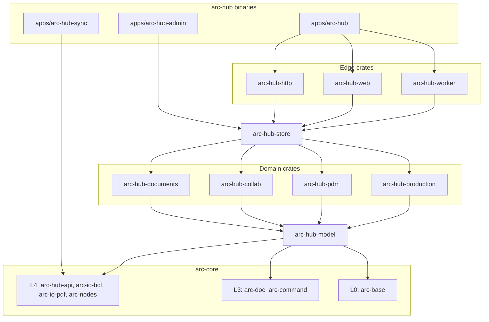

# Arc Hub

Self-hostable collaboration and data-management server for design projects, part of the Arc
suite.

> **Status: design phase.** No builds are available yet. This repository contains the product definition, architecture and roadmap that implementation follows.

## What it is

Arc Hub is one Rust server that an organization runs on its own hardware or cloud account to
share and control design data. It combines a common data environment (projects, permissions,
versioned files, viewing, markups, issues, reviews, transmittals and ISO 19650 information
management), design collaboration (packages between teams, automatic clash runs, multi-user
editing), product data management (check-in and check-out, revisions, lifecycles, items, bills of
materials, change orders) and production tracking (entities, tasks, review playlists, schedules),
on a platform of open APIs, webhooks and automation jobs that run headless Arc applications.

## Who it is for

Information managers, architects, engineers and contractors on building and infrastructure
projects; mechanical and manufacturing engineering teams; producers, supervisors and artists in
media production; and the IT administrators and integrators who run and connect the server.

## Capability areas

| Area | Scope | Specification |
|---|---|---|
| Organizations and projects | Tenancy, projects, templates, companies, notifications | [01](docs/product/capabilities/01-organizations-projects.md) |
| Identity and access | Accounts, sign-in, provisioning, membership, permission model | [02](docs/product/capabilities/02-identity-access.md) |
| Files and versions | Folders, documents, immutable versions, transfer, locks, references, trash | [03](docs/product/capabilities/03-files-versions.md) |
| Viewing and comparison | Browser viewer, sheets, document sets, 2D and 3D comparison | [04](docs/product/capabilities/04-viewing-comparison.md) |
| Markups | 2D and 3D markups, sets, publishing, export | [05](docs/product/capabilities/05-markups.md) |
| Issues | BCF-native issues, workflows, viewpoints, BCF API | [06](docs/product/capabilities/06-issues.md) |
| Reviews and approvals | Workflow templates, decisions, gate rules, signatures | [07](docs/product/capabilities/07-reviews-approvals.md) |
| Transmittals and packages | Formal issue of versions, receipts, responses, document packages | [08](docs/product/capabilities/08-transmittals-packages.md) |
| Information management | Properties, naming standards, container states, delivery plans | [09](docs/product/capabilities/09-information-management.md) |
| Search | Permission-correct global, content and element search | [10](docs/product/capabilities/10-search.md) |
| Desktop synchronization | Arc application integration, sync agent, WebDAV | [11](docs/product/capabilities/11-desktop-sync.md) |
| Construction records | RFIs, submittals, forms, photos, schedules, cost, meetings | [12](docs/product/capabilities/12-construction-records.md) |
| Design packages | Teams, package versions, shared timeline, cross-organization shares | [13](docs/product/capabilities/13-design-packages.md) |
| Multi-user editing | Change sets, element borrowing, conflicts, branches and merges | [14](docs/product/capabilities/14-multi-user-editing.md) |
| Coordination | Model sets, automatic clash runs, rule-based model checking | [15](docs/product/capabilities/15-coordination.md) |
| Product data: files | Check-in and check-out, revisions, lifecycles, categories, numbering | [16](docs/product/capabilities/16-pdm-files.md) |
| Product data: items | Items, bills of materials, where-used, copy design | [17](docs/product/capabilities/17-items-structure.md) |
| Product data: change | Change requests and orders, reports, enterprise publication | [18](docs/product/capabilities/18-change-orders.md) |
| Production: entities | Entity types, fields, tasks, pipeline steps, published outputs | [19](docs/product/capabilities/19-production-entities.md) |
| Production: review | Submissions, player, notes, playlists, client review | [20](docs/product/capabilities/20-production-review.md) |
| Production: planning | Gantt, calendars, bookings, capacity, time logs | [21](docs/product/capabilities/21-production-planning.md) |
| API and webhooks | REST API, client authorization, events, openCDE APIs | [22](docs/product/capabilities/22-api-webhooks.md) |
| Automation and jobs | Job queue, headless Arc runners, triggers, rules, guards | [23](docs/product/capabilities/23-automation-jobs.md) |
| Model data services | Derivatives, element index, granular queries, data exchange | [24](docs/product/capabilities/24-model-data.md) |
| Administration | Audit trail, reports, extracts, retention, export | [25](docs/product/capabilities/25-administration.md) |
| Operations | Installation, upgrades, backup, observability, scaling | [26](docs/product/capabilities/26-operations.md) |
| Integrations | Arc suite, collaboration tools, migration, enterprise systems | [27](docs/product/capabilities/27-integrations.md) |
| Assistant | Optional assistance and agent access boundaries | [28](docs/product/capabilities/28-assistant.md) |

## How it fits in the suite

Arc Hub is the collaboration server of the Arc suite. Arc applications work fully without it and
connect to it when collaboration is wanted. It uses the three suite contracts:

- **Hub API**: the contract between the server and every Arc application, defined in the
  `arc-hub-api` crate of [arc-core](https://github.com/ACKaraca/arc-core).
- **Arc document package**: Arc native documents are stored as versions; their metadata,
  references and operation journals are read with `arc-doc` for comparison, change sets and merges.
- **Arc Scene**: render jobs hand scenes to RenderBuilder farm workers.

Format processing, clash detection and automation run in headless Arc applications on Hub
workers, and the browser viewer is the Arc Review viewer compiled to WebAssembly.

## Architecture at a glance

Details: [architecture overview](docs/architecture/overview.md).

## Roadmap

| Milestone | Suite phase | Goal |
|---|---|---|
| M1 Documents core | 2 | Store, version, view and discuss files; Arc applications open and save through the Hub |
| M2 Controlled information exchange | 2 | ISO 19650 states, reviews, transmittals, markups, search |
| M3 Design collaboration and automation | 3 | Design packages, automatic clash runs, headless Arc jobs |
| M4 Product data | 3 | Lifecycles, items, bills of materials, change orders |
| M5 Production tracking and construction records | 4 | Media productions and construction phases on the same server |
| M6 Depth and scale | 5 | Multi-user editing, model merges, federation, assistance |

Full milestones and exit criteria: [roadmap](docs/roadmap.md).

## Documentation

See the [documentation map](docs/README.md). Contributors and coding agents start with
[AGENTS.md](AGENTS.md).

## Contributing

Contributions follow [CONTRIBUTING.md](CONTRIBUTING.md). Report security issues as described in
[SECURITY.md](SECURITY.md).

## License

Licensed under the Apache License, Version 2.0; see [LICENSE](LICENSE) and [NOTICE](NOTICE).

## Trademarks

Arc, ArchBuilder, DraftBuilder, CivilBuilder, SolidBuilder, MeshBuilder, RenderBuilder, Arc Review and Arc Hub are names of this project and are not covered by the Apache License; see the [trademark policy](https://github.com/ACKaraca/arc-suite/blob/main/TRADEMARKS.md). All other product and company names are trademarks of their respective owners and are used only to describe scope and interoperability.
