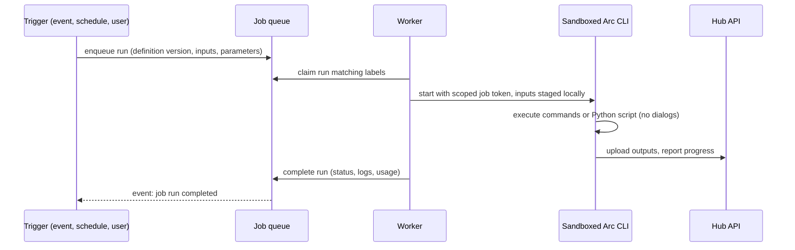

# API design

The Hub API is the contract between Arc Hub and every client: Arc applications, the sync agent,
scripts, integrations and agents. Its types live in `arc-core` as the `arc-hub-api` crate, so the
server and the Rust client share one definition. Capabilities are listed in
[`22-api-webhooks.md`](../product/capabilities/22-api-webhooks.md).

## Resource model

Resources are JSON objects addressed under `/api/v1`. Every resource has `id`, `type`, `etag`,
`created_at`, `updated_at` and `links` (self and related resources). Paths follow ownership:

| Path | Resource |
|---|---|
| `/orgs/{org}` | Organization, with `members`, `groups`, `companies`, `roles`, `templates`, `property-definitions`, `service-accounts`, `clients` |
| `/orgs/{org}/projects/{project}` | Project, with `members`, `settings`, `modules` |
| `…/folders/{folder}` | Folder, with `children`, `documents`, `grants`, `settings` |
| `…/documents/{document}` | Document, with `versions`, `lock`, `references`, `used-by`, `properties` |
| `…/documents/{document}/versions/{n}` | Version, with `content`, `derivatives`, `elements`, `markups`, `sheets` |
| `…/records/{family}/{record}` | Issue, review, transmittal, change order, RFI, submittal, form, task and other records, with `comments`, `decisions`, `links`, `history` |
| `…/model-sets/{set}`, `…/clash-tests/{test}` | Coordination resources and results |
| `…/packages/{package}`, `…/teams/{team}` | Design collaboration |
| `/orgs/{org}/items/{item}` | Items, with `revisions`, `bom`, `where-used` |
| `…/entities/{type}/{entity}`, `…/playlists/{playlist}` | Production tracking |
| `/orgs/{org}/jobs`, `…/job-definitions`, `…/rules` | Automation |
| `/orgs/{org}/events`, `…/webhooks` | Event feed and subscriptions |
| `/orgs/{org}/queries` | Granular element queries |

Organization and project segments accept identifiers or short codes. Short identifiers in paths
are resolved once per request and never cached across requests, so renames take effect at once.

Operations that are not create, read, update or delete are explicit sub-resources
(`POST …/versions/{n}/transitions`, `POST …/documents/{document}/lock`), each mapped to one
registered operation in the server. The OpenAPI description is generated from the operation
registry, so it cannot omit or misstate an operation.

## Authentication and authorization

| Client | Grant | Token |
|---|---|---|
| Browser (web client) | Session cookie from OpenID Connect, SAML or local sign-in | Not an API token; the web client calls domain operations in process. |
| Arc applications, command-line tools | Authorization code with PKCE (loopback) or device authorization | Access token (15 minutes), rotating refresh token |
| Third-party web applications | Authorization code with PKCE and consent | Same |
| Service accounts | Client credentials with secret or private-key JWT | Access token only |
| Scripts by a person | Personal access token | Opaque token, stored hashed on the server |
| Agents | Authorization code with PKCE as the user, or a service account | Same, marked as agent client |

Scopes limit what a token can do (`documents:read`, `documents:write`, `records:write`,
`pdm:write`, `production:write`, `admin`, `jobs:run` and so on). The effective right of a request
is the intersection of token scopes and the principal's permissions; scopes never add permissions.
Access tokens are signed JWTs with a key identifier, verified locally by every node; revocation of
refresh tokens and personal access tokens is immediate, and access tokens expire quickly enough
that no revocation list is needed. Details are in [`security.md`](security.md).

## Versioning

- The major version is in the path (`/api/v1`). A new major version is introduced only for
  incompatible changes and runs alongside the previous one for at least one major server release.
- Within a major version, changes are additive: new resources, new optional fields, new enum
  values. Clients must ignore unknown fields and tolerate unknown enum values.
- Deprecated operations carry `Deprecation` and `Sunset` headers for at least two minor server
  releases before removal; the server's release notes list them.
- `GET /api/versions` and the openCDE Foundation versions endpoint report supported versions.
- `arc-hub-api` follows the `arc-core` release and states the API versions it supports; an Arc
  application refuses to write through an API version it does not know.

## Collections, filtering and pagination

- Cursor pagination: `?limit=` (default 50, maximum 500) and an opaque `cursor`; responses include
  `next` and `prev` links. Offsets are not supported because they are unstable under concurrent
  writes.
- Filtering uses the documented query grammar shared with search: `?filter=state:published AND
  originator:ABC`. Unknown fields are a 400 error, not ignored.
- Sorting: `?sort=-updated_at,name` on fields declared sortable per resource.
- Sparse fields: `?fields=id,name,current_version` reduces payloads for large listings.
- Counts are returned only when requested (`?count=true`), since exact counts are expensive on
  permission-filtered queries.

## Consistency

- Every resource returns an `ETag`; updates and deletes require `If-Match` and return 412 when the
  resource changed.
- POST requests accept `Idempotency-Key`; a repeated key within 24 hours returns the original
  result.
- Bulk operations (`POST …/bulk`) declare atomic or per-item semantics in the operation; per-item
  results report status and problem details for each element.
- Long operations (copy design, exports, merges) return `202 Accepted` with an operation resource
  and emit an event on completion.
- Errors use RFC 9457 problem details with a stable `code`, `title`, `detail` and, for validation,
  per-field `errors`. Error bodies never contain stack traces, SQL or paths.

## Files

- Uploads use tus 1.0 at `/api/v1/uploads`; the final `PATCH` is followed by a commit operation
  that names the target folder or document, the expected digest and properties. A version exists
  only after commit.
- Downloads of `…/versions/{n}/content` support `Range` and `If-None-Match`; with S3-compatible
  storage the server can answer with a redirect to a presigned URL valid for 15 minutes.
- Derivatives are fetched through `…/derivatives/{kind}` with the same rules.

## Events and webhooks

Events are CloudEvents 1.0 JSON with Hub extensions:

| Attribute | Content |
|---|---|
| `id` | Event identifier |
| `source` | `/orgs/{org}/projects/{project}` |
| `type` | Dotted type, for example `arc.hub.document.version.created` |
| `subject` | Path of the affected resource |
| `time` | Commit time |
| `arcseq` | Monotonic sequence number per organization |
| `arccausation` | Chain of event identifiers that caused this event (rule loop control) |
| `data` | Resource snapshot or minimal reference, filtered by the reader's permissions |

Events are written in the same transaction as the change (transactional outbox) and dispatched
after commit. Webhook deliveries are signed with `HMAC-SHA256(secret, timestamp + "." + body)` in
a signature header carrying the timestamp; receivers should reject timestamps older than five
minutes. Delivery is at least once; receivers deduplicate by `id`. Ordering is guaranteed per
`subject` within one subscription, not across subjects. Clients that cannot accept inbound calls
read `GET /orgs/{org}/events?after={seq}` and long-poll for new events.

## Alignment with openCDE and the BCF API

| Standard | Implementation |
|---|---|
| Foundation API | Version discovery and authentication discovery pointing at the Hub authorization server. |
| BCF API 3.0 | Projects map to Hub projects with issues enabled; topics are issues; comments, viewpoints, snapshots and document references map one to one. Project extensions publish the issue types, statuses, priorities, labels and users of the project. Hub-only fields appear as extensions and are preserved on round trips. |
| Documents API | Document selection and upload sessions are served by Hub web pages; downloads and uploads go through the same version and commit operations as the REST API. |

The BCF API and the REST issue resources operate on the same records; neither is a copy of the
other.

## Automation-job model

- A **job definition** names the runner (an Arc application command-line tool and version range),
  a command identifier or script, a parameter schema, input selectors, output rules, limits and
  worker labels. Definitions are versioned; a run records the definition version it used.
- A **run** receives a job token for the definition's service account, limited to the run's
  project and inputs and valid for the run's time limit. The token is the only credential the
  sandbox has.
- The runner speaks the Arc Automation Protocol to the application inside the sandbox; parameters
  are validated against the command's schema from `arc-command` before the run starts.
- Outputs are uploaded through the normal API and become versions or derivatives with the run as
  their origin; nothing bypasses permissions or the audit trail.
- System jobs (derivatives, extraction, clash runs) use the same mechanism with a system identity
  restricted to derivative writes.
