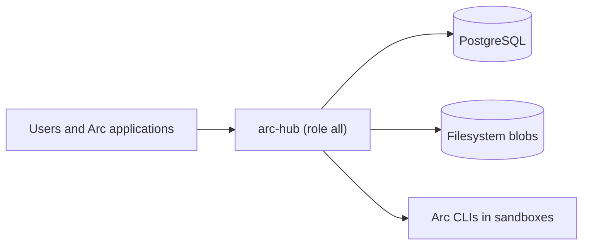
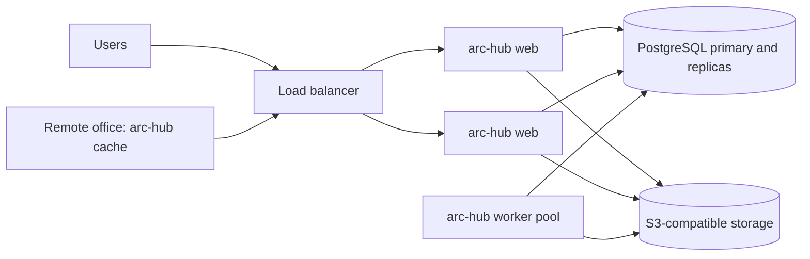

# Deployment architecture

How Arc Hub runs from a single node to a scaled installation, and how it is backed up, restored,
upgraded and observed. Capabilities are listed in
[`26-operations.md`](../product/capabilities/26-operations.md).

## Building blocks

| Component | Required | Notes |
|---|---|---|
| `arc-hub` binary | yes | Roles: `all`, `web`, `worker`, `cache` ([ADR-0001](../adr/0001-single-binary-server.md)). |
| PostgreSQL | yes | Metadata, search, queue, outbox, sessions ([ADR-0002](../adr/0002-postgresql-and-blob-storage.md)). Supported major versions are stated in each release. |
| Blob storage | yes | Local or network filesystem, or any S3-compatible service. |
| Arc command-line applications | for workers | Installed next to the worker, or in the worker container image; their versions are reported to the server. |
| SMTP relay | optional | Email notifications. |
| Identity provider | optional | OpenID Connect or SAML; local accounts otherwise. |
| Reverse proxy or load balancer | optional | TLS termination and multiple web nodes. |

Configuration is one TOML file plus environment variable overrides; every secret is a reference
(see [`security.md`](security.md)). `arc-hub-admin config check` validates a configuration
before use.

## Topologies

### Single node

One machine runs `arc-hub --role all`, PostgreSQL and a filesystem blob store. This is the
reference installation for small firms and evaluation, and the basis of the performance targets
in the [architecture overview](overview.md#performance-targets). The worker runs inside the same
process with a configurable concurrency so interactive requests keep priority.

### Separated workers

The web role runs on one node and one or more worker nodes run `arc-hub --role worker`, each with
the Arc applications it offers and labels (for example `gpu`, `windows`). Workers need database
and blob storage access and outbound access to the web node; they accept no inbound connections.

### Scaled

- Web nodes are stateless; sessions, rate-limit counters and push fan-out use PostgreSQL
  (`LISTEN`/`NOTIFY` for fan-out), so any node can serve any request.
- Read-heavy listings can be directed to PostgreSQL read replicas where replication lag is
  acceptable; writes and permission-sensitive reads that follow a write use the primary.
- Worker pools scale independently by queue depth.
- Remote offices can run a cache node (HB-OPS-022) that serves downloads and viewables from local
  copies after authorizing each request with the main server. Sites that must write locally join a
  replication group (HB-OPS-023 to HB-OPS-030), where each peer is a complete installation with
  its own database and storage ([ADR-0009](../adr/0009-asynchronous-multi-site-replication.md)).
- High availability relies on a highly available PostgreSQL service and redundant storage; Arc Hub
  adds no consensus layer of its own.

## Backup and restore

| Aspect | Design |
|---|---|
| Consistency | Blobs are immutable and written before the version row commits; a database backup followed by a blob copy is always consistent. Garbage collection waits seven days before deleting unreferenced blobs, so blobs referenced by a recent database backup still exist. |
| Filesystem installs | `arc-hub-admin backup` writes one archive containing a database dump and new blobs since the previous backup, with a manifest of digests. |
| S3-compatible storage | Bucket versioning or replication plus PostgreSQL point-in-time recovery; the documentation gives the procedure and the recovery-point arithmetic. |
| Verification | `arc-hub-admin restore --verify` checks that every referenced blob exists with the right digest and that audit chains verify. |
| Project-level restore | A project can be extracted from a backup into a new project on a running server (HB-OPS-014). |
| Organization portability | Organization export and import (HB-ADMIN-012) move one tenant between servers. |

## Upgrades and migrations

- Server releases follow semantic versioning. Minor releases within a major version support
  rolling upgrades: old and new nodes run together while the upgrade proceeds.
- Migrations are embedded, ordered and forward-only. Each schema change uses expand and contract:
  release N adds new structures and writes both shapes; release N+1 stops using the old shape;
  release N+2 removes it. Contract migrations never run in the same release as their expand step.
- Long data migrations run as background jobs with progress, not inside the migration lock.
- `arc-hub-admin upgrade check` reports the current schema, pending migrations, blockers (for
  example contract steps not yet allowed) and required PostgreSQL version.
- The server refuses to start against a schema newer than it knows, and never downgrades a schema.
  Rollback means restoring the pre-upgrade backup.
- Arc command-line applications on workers can be upgraded independently; job definitions name
  version ranges, and derivatives record the converter version that produced them.

## Observability

| Signal | Design |
|---|---|
| Health | `/health/live`, `/health/ready` (database, storage, migrations), `/version`. |
| Metrics | OpenMetrics endpoint: request rate and latency per route, error rate, queue depth and age per job kind, job duration and failures, webhook backlog, database pool, storage latency, active sessions and borrows. |
| Logs | Structured JSON to standard output with request identifier, organization identifier and principal identifier; no file content, tokens or secret values. |
| Traces | OpenTelemetry spans for requests, operations, database calls, storage calls and jobs, exported over OTLP when configured. |
| Audit | Separate from logs; streamed to syslog or HTTPS collectors when configured (HB-ADMIN-003). |
| Alerts | The documentation provides alert rules for queue age, webhook backlog, failed migrations, storage errors and certificate expiry. |

## Sizing guidance

Sizing is published as guidance with the first release, derived from load tests against the
performance targets. The design assumptions are: database size grows with records and element
indexes rather than with file size; blob storage grows with content and derivatives (viewables
add roughly the size of the source for model formats); worker capacity is driven by derivative
and clash workload, not by user count.
