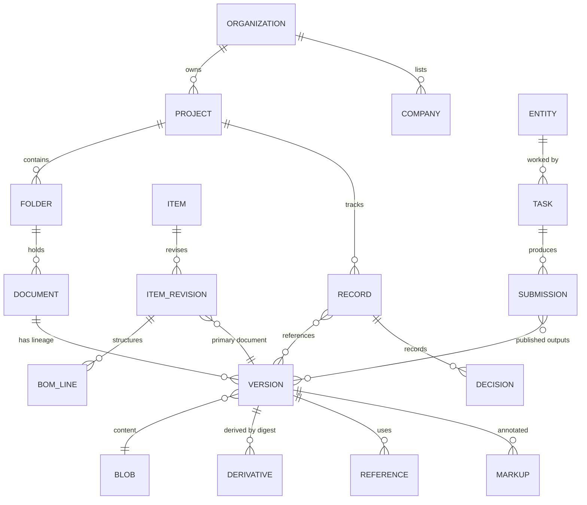
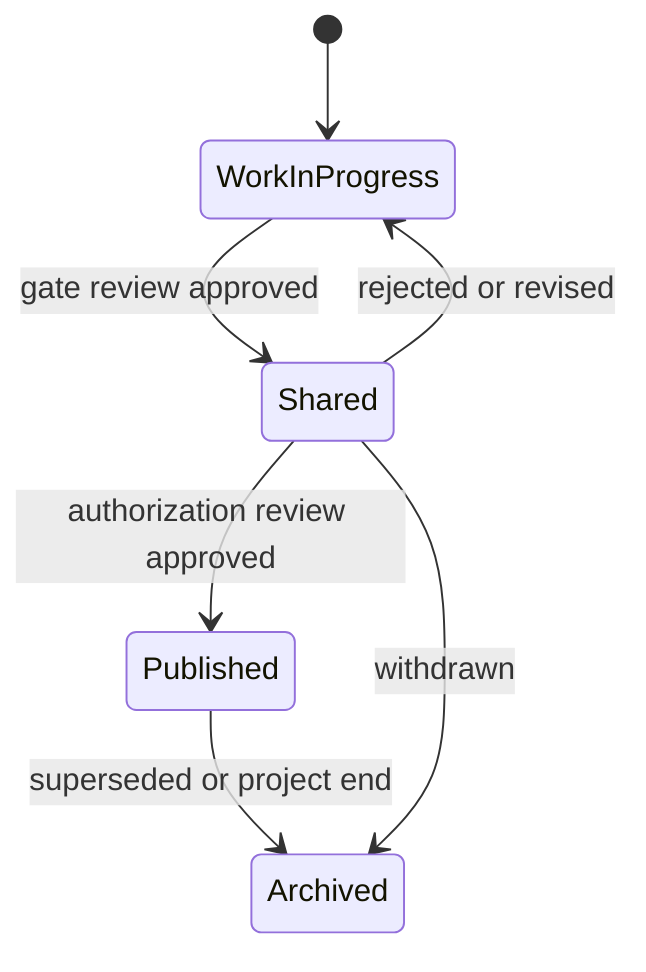

# Domain model

The object types of Arc Hub, their key properties, relationships, invariants, identity rules and
what recomputes when something changes. Field lists name the properties that matter for schema
design; audit columns (created and updated by and at) exist on every table and are omitted.

## Identity rules

- Every object has a 128-bit identifier from `arc-base`, generated by the server (UUID version 7
  layout, so identifiers sort by creation time). Identifiers are never reused and never change on
  rename, move or state change.
- Human-readable numbers (project number, issue number, transmittal number, item number) are
  separate, unique within their scope, immutable once assigned and never reused.
- Every row except server-level ones carries `org_id`; every project-scoped row carries
  `project_id`. Queries are always constrained by `org_id` (see [`security.md`](security.md)).
- Content is identified by SHA-256 digest. A blob is stored once per storage location.
- Elements of models are identified by the source's stable identifier (Arc object identifier or
  IFC GlobalId) and are only meaningful together with a document identifier.
- BCF topics, comments and viewpoints keep their GUIDs as identifiers.

## Tenancy and access

| Type | Key properties | Notes |
|---|---|---|
| Organization | id, short_code, name, locale, time_zone, storage_location_id, status | Tenancy boundary. |
| Project | id, org_id, number, code, name, kind, status (active, archived, template), modules, location, crs_code, template_origin_id | `number` unique per organization. |
| Company | id, org_id, short_code, name, trade, external_ids | |
| User | id, display_name, email, locale, time_zone, status | Server-level. |
| IdentityLink | user_id, provider_id, subject | Unique (provider_id, subject). |
| OrgMembership | org_id, user_id, org_role, company_id, status | Exactly one company per member and organization. |
| ProjectMembership | project_id, principal (user, group or company), roles[], module_access{} | |
| Group | id, org_id, name, managed_by (local or directory), members[] | Nesting depth at most 5, acyclic. |
| Role | id, org_id, project_id (nullable), name | |
| Grant | id, scope (project, folder, record type), principal, level, expires_at | |
| StateCap | state_ref, principal, max_level | Owned by a container state or lifecycle state. |
| ServiceAccount | id, org_id, name, keys[], status | A principal like a user. |
| OAuthClient, AccessToken | client_id, redirect_uris, scopes / token hash, subject, scopes, expiry | Tokens stored hashed. |

**Invariants**: a project has at least one administrator; a member's effective folder level is
`min(max(applicable grants), state cap)`; a grant never names a principal from another
organization except through a cross-organization share.

## Documents

| Type | Key properties | Notes |
|---|---|---|
| Folder | id, project_id, parent_id, name, settings (overrides), inherit_grants | Sibling names unique ignoring case. |
| Document | id, project_id, folder_id, name, current_version_no, lock, category_id, lifecycle_state, branch_of | Lineage of versions. |
| Version | id, document_id, number, blob_digest, size, uploader, comment, client_app, source_revision, container_state, suitability, revision_label, review_status, incomplete | Content and system fields immutable. |
| PropertyValue | target (version, item, record, entity), definition_id, value, history[] | Typed by definition. |
| Blob | digest, storage_location_id, size, ref_count_hint | Garbage-collected after grace period. |
| Lock | document_id, holder, client, acquired_at, expires_at | At most one per document. |
| Reference | from_version_id, to_document_id, pinned_version_no (nullable), relative_path, kind (reference, attachment) | Null pin means latest. |
| Derivative | digest, kind, converter_version, status, storage_key, loss_report | Unique (digest, kind, converter_version). |
| Sheet | id, project_id, number, title, discipline, revisions[] (version_id, page, revision) | Stacked by number. |
| DocumentSet | id, name, date, members[] (version_id) | Immutable after creation. |
| Markup, MarkupSet | version_id, set_id, author, geometry, state (draft, published), status, revision_of | |
| NamingStandard | id, project_id, fields[] (kind, dictionary, pattern, width), separators | |
| ContainerStateDef, SuitabilityCode | project_id, state, caps / code, allowed_states | |
| DeliveryPlanEntry | expected_name, company_id, milestone, target_state, linked_document_id | |

**Invariants**: version numbers of a document are contiguous from 1; a version's blob exists
before the version row commits; a locked document accepts versions only from the lock holder; a
version in a container state with a gate rule entered it through an approved review; a published
revision supersedes the previous published revision of the same document.

## Records and workflows

Issues, reviews, transmittals, change requests, change orders, RFIs, submittals, forms, meetings
and production tasks are **records** on one engine ([ADR-0006](../adr/0006-record-workflow-engine.md)).

| Type | Key properties | Notes |
|---|---|---|
| RecordType | id, project_id, family (issue, rfi, change_order, ...), name, number_pattern, workflow_id, field_set, permissions | |
| Record | id, type_id, number, title, status, assignees[], watchers[], due_at, fields{}, family payload | Family payload holds typed columns, for example the BCF data of an issue. |
| Workflow | statuses[] (name, category), transitions[] (from, to, principals, required_fields) | |
| StepRoute | steps[] (participants, kind, completion_rule, due_offset, on_reject), branches | Used by reviews, change orders, submittals. |
| Decision | record_id, step, item_ref, principal, outcome, comment, signature_manifest | Immutable. |
| Comment | record_id, author, body, attachments[], viewpoint_id, edits[] | |
| Viewpoint | id, camera, sections, visibility, selection[], snapshot_blob | BCF viewpoint model. |
| RecordLink | from_record, to (record, version, element, clash group) | |
| Transmittal | record fields plus items[] (version_id), recipients[], receipts[], responses[] | Items fixed at send. |
| DocumentPackage | id, name, package_version, items[], state | |

**Invariants**: a record's status is always one of its workflow's statuses and changes only along
allowed transitions; decisions and sent transmittals are never edited; a change order reserves its
affected records exclusively.

## Design collaboration

| Type | Key properties | Notes |
|---|---|---|
| Team | id, project_id, name, company_id, members[], area_folder_id | |
| DesignPackage | id, team_id, name, recipients[], contents[] (document, pin, element_filter) | |
| PackageVersion | package_id, number, resolved[] (version_id, filter_result_derivative), note | Immutable. |
| Consumption | team_id, package_id, package_version | One current consumption per team and package. |
| TimelineEvent | project_id, kind (share, consume, update, revert), refs, at | Append-only. |
| CrossOrgShare | owner_folder_id, recipient_project_id, direction, max_level, status | |
| SharedDocument | document_id, snapshot_version_id, snapshot_seq, head_seq | Multi-user mode. |
| ChangeSet | shared_document_id, seq, base_seq, author, ops_blob, element_ids[], commands[] | `seq` contiguous per document. |
| Borrow | shared_document_id, element_id, holder, session_id | Unique (shared_document_id, element_id). |
| ConflictRecord | shared_document_id, change_set_id, element_ids[], local_state, remote_state, resolution | |
| Branch, Merge | document_id, base_version_no / source, target, base, result_version_id, conflicts[] | |
| ModelSet, ModelSetSnapshot | members[] (document, group, transform, pin) / resolved versions | |
| ClashTest, ClashRun, Clash, ClashGroup | groups, kind, tolerance, rules / snapshot_id / (test_id, element_a, element_b), state, manual_status / members[] | Clash unique per test and ordered pair. |
| CheckRuleSet, Finding | rules (IDS blob or query) / element_ref, rule, state | |

**Invariants**: a change set is accepted only if every element it modifies is borrowed by its
author or unborrowed and borrowable; change sets apply in `seq` order; a conflict record is never
deleted until resolved; a clash's state history is append-only.

## Product data

| Type | Key properties | Notes |
|---|---|---|
| Category | id, org_id, applies_to, rules[] (order, condition), lifecycle_id, revision_scheme_id, numbering_scheme_id, property_set | |
| LifecycleDef | states[] (name, released, locked, obsolete, caps), transitions[] (from, to, principals, conditions[], actions[]) | |
| RevisionScheme | segments[] (sequence, excluded, width) | Shared with container revision codes. |
| NumberingScheme, Counter | segments[] / scheme_id, prefix, next | Counters never decrease. |
| PropertyMapping | definition_id, format, file_property, direction | |
| Item | id, org_id, number, category_id, uom, lifecycle_state, current_revision | |
| ItemRevision | item_id, revision_label, state, properties{}, primary_document_version, secondary[] | Frozen when released. |
| BomLine | parent_revision_id, child_item_id, quantity, uom, position, ref_designators, source (extracted, manual), override_reason | |
| ItemLink | from_item, to_item, kind (alternate, substitute, related) | |
| ChangeOrder | record fields plus affected[] (target, from_revision, to_revision, to_state) | |
| PublicationRun | target, payload_digest, status, acks[] | |

**Invariants**: an item revision has exactly one primary document version once released; a
released revision is never modified; a BOM graph is acyclic (a cycle is refused at extraction or
edit); a document in a locked lifecycle state cannot be checked out.

## Production tracking

| Type | Key properties | Notes |
|---|---|---|
| EntityType | id, org_id, project_id (nullable), name, builtin_kind, fields[] | |
| FieldDef | key, type, required, default, formula or summary spec | Formula graph acyclic. |
| Entity | id, type_id, project_id, code, status, fields{} | |
| PipelineStep | id, project_id, code, name, color, entity_types[] | |
| Task | record fields plus entity_id, step_id, start, due, duration, estimate, dependencies[] (task, kind, lag) | Dependency graph acyclic. |
| Submission | id, task_id, entity_id, media[], outputs[] (version_id), status, client_status | |
| PublishedOutput | version_id, entity_id, task_id, output_type, frame_range, color_space, upstream[] | |
| Playlist | id, items[] (submission_id, order), filter, locked | |
| Note | record fields plus addressees, frame, annotation_blobs[] | |
| Booking, TimeLog, Calendar | person or department, period, allocation / task, day, minutes, state / working days and exceptions | |

## Platform

| Type | Key properties | Notes |
|---|---|---|
| Event | org_id, seq, type, subject, time, data, causation[] | `seq` monotonic per organization. |
| WebhookSubscription, Delivery | target, filters, secret_ref, state / event_seq, attempts, status | |
| JobDefinition | runner, version_req, command or script, parameter_schema, inputs, outputs, limits, labels | Versioned. |
| JobRun | definition_version, inputs[], outputs[], state, worker_id, logs_blob, usage | |
| AutomationRule | event_filter, condition, actions[] or graph_blob, enabled | |
| ElementRecord | version_id, element_id, class, name, container_id, properties (typed, with unit) | |
| SavedQuery, Exchange | filter, aggregations / source_document, query, versions[] | |
| AuditRecord | org_id, seq, time, actor, on_behalf_of, action, object, summary, prev_hash, hash | Append-only, hash-chained. |

## Relationships

## Dependency and recomputation rules

| When | Then |
|---|---|
| A version is committed | Derivative jobs are enqueued unless derivatives exist for its digest; references are extracted and resolved; naming and property compliance is evaluated; events trigger rules, model-set updates and package notifications. |
| A document is renamed or moved | Nothing derived changes (references are by identifier); path-based references of other documents are flagged for repair (HB-ITEM-019). |
| A referenced document gets a new version | References pinned to latest resolve to it on next read; dependents show an update indicator. |
| A container or lifecycle state changes | Effective permissions change immediately (evaluated at read); supersede rules run; transition actions enqueue jobs. |
| A record changes status | Summary fields and status propagation rules run as follow-up events, never inside the transaction. |
| A model set changes | A snapshot is created; affected clash tests and rule sets are enqueued. |
| A clash run completes | Clash states are updated by identity; linked issues receive resolution suggestions. |
| A change set is accepted | Head sequence advances; subscribers receive it; snapshot job is scheduled when the backlog exceeds its threshold. |
| A grant changes | No stored data changes; caches of permission decisions for affected principals are invalidated. |
