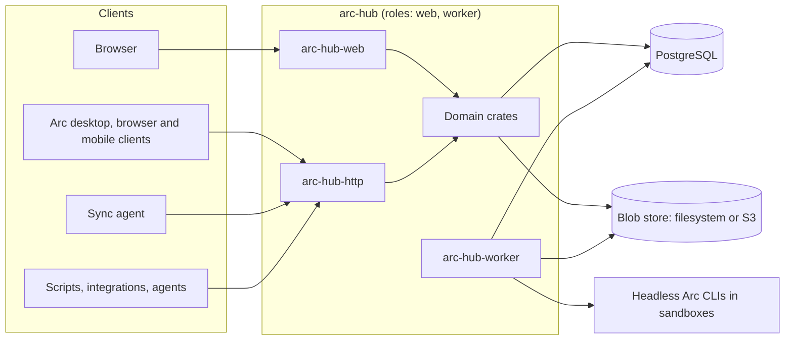
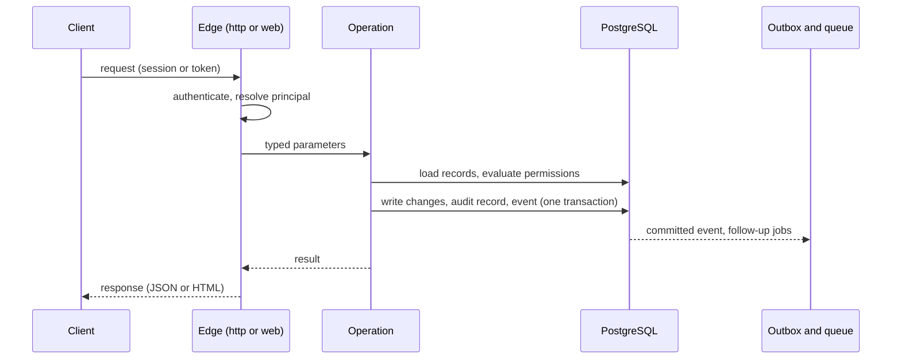

# Architecture overview

How Arc Hub is built: the crates of this repository, the `arc-core` crates it uses, the runtime
flows of a request and of background work, and the targets and tests that hold the design together.
The API, security model and deployment are detailed in [`api.md`](api.md),
[`security.md`](security.md) and [`deployment.md`](deployment.md).

## Shape of the system

Arc Hub is one Rust server binary backed by PostgreSQL and a blob store
([ADR-0001](../adr/0001-single-binary-server.md), [ADR-0002](../adr/0002-postgresql-and-blob-storage.md)).
The same binary serves the REST API, the server-rendered web client and push channels, and runs
the job worker; a role chosen at startup decides which of these a process performs. Heavy geometry
work never runs inside the server: it is delegated to headless Arc applications executed by the
worker in sandboxed processes ([ADR-0005](../adr/0005-headless-arc-runners.md)). The browser client
is server-rendered HTML with progressive enhancement and embeds the Arc Review viewer compiled to
WebAssembly ([ADR-0003](../adr/0003-server-rendered-web-client.md)); for authoring it loads the
browser build of the owning Arc product. Native mobile clients use the same public API
([ADR-0007](../adr/0007-native-mobile-clients.md)).

## Repository crates

| Path | Kind | Responsibility |
|---|---|---|
| `crates/arc-hub-model` | library | Shared domain kernel: identifiers, tenancy, accounts, membership, the permission evaluator ([ADR-0004](../adr/0004-unified-permission-model.md)), the property engine, the record and workflow engine ([ADR-0006](../adr/0006-record-workflow-engine.md)), the operation registry, event and audit types. No I/O. |
| `crates/arc-hub-documents` | library | Documents module: folders, documents, versions, locks, references, sheets, document sets, markups, issues, reviews, transmittals, packages, naming standards, container states, search queries, construction records. |
| `crates/arc-hub-collab` | library | Design collaboration: teams, design packages and timeline, cross-organization shares, multi-user sessions, change sets, borrows, branches and merges, model sets, clash and check results. |
| `crates/arc-hub-pdm` | library | Product data: check-in and check-out rules, revisions and revision schemes, lifecycles, categories, property mapping, numbering, items, structures, where-used, copy design plans, change orders, release publication. |
| `crates/arc-hub-production` | library | Production tracking: entity types and fields, calculated and summary fields, pipeline steps, tasks, status propagation, submissions, playlists, notes, schedules, bookings, time logs. |
| `crates/arc-hub-store` | library | Persistence: PostgreSQL repositories and embedded migrations, transactional outbox, job queue tables, full-text index, the blob store over filesystem and S3-compatible backends, tus upload sessions. |
| `crates/arc-hub-http` | library | HTTP surface on axum: REST API and OpenAPI generation, the OAuth authorization server, openCDE Foundation, BCF and Documents APIs, WebDAV, SCIM, push channels, the Model Context Protocol endpoint. |
| `crates/arc-hub-web` | library | Server-rendered web client: page handlers, HTML templates, forms, progressive-enhancement assets, localization catalogues, the viewer page that loads the Arc Review WebAssembly build. |
| `crates/arc-hub-worker` | library | Background work: queue consumption, system jobs, the sandboxed runner for headless Arc applications, webhook and email delivery, retention and garbage collection, guard plug-in host. |
| `apps/arc-hub` | binary | The server. Wiring and configuration only; roles `all`, `web`, `worker`, `cache`. |
| `apps/arc-hub-admin` | binary | Administration command: setup, migrations, configuration check, backup and restore, integrity and audit verification, key rotation, reindexing, organization export and import. |
| `apps/arc-hub-sync` | binary | Desktop sync agent for files of applications that do not connect to the Hub themselves (HB-SYNC-008); depends only on `arc-hub-api`. Added with milestone M3 of the [roadmap](../roadmap.md). |
| `xtask` | tooling | Workspace tasks, including the layer check. |

Dependency direction inside the repository: `arc-hub-model` ← module crates ← `arc-hub-store`
(implements repository traits declared by the domain crates) ← `arc-hub-http`, `arc-hub-web`,
`arc-hub-worker` ← binaries. Domain crates never depend on axum, SQL drivers or storage SDKs, so
the domain is testable without a database.

## Use of arc-core

| Crate | Layer | Used for |
|---|---|---|
| `arc-base` | L0 | Stable 128-bit identifiers, units and quantities in property values and element queries, error types. |
| `arc-doc` | L3 | Reading Arc document packages headless: metadata, thumbnails, external references and journal ranges for change sets, version comparison and merges. The server never regenerates geometry. |
| `arc-command` | L3 | Command identifiers and parameter schemas of Arc applications, used to validate job definitions and to generate job parameter forms. |
| `arc-nodes` | L4 | Evaluation of automation rule graphs (HB-JOB-016) with bounded steps. |
| `arc-io-bcf` | L4 | BCF archive import and export (HB-ISSUE-019, HB-ISSUE-020) and the BCF API data model. |
| `arc-io-pdf` | L4 | Generation of cover sheets, review reports and registers as PDF. |
| `arc-hub-api` | L4 | The Hub API types and the Rust client, shared with Arc applications and the sync agent. The server implements exactly these types, so client and server cannot drift. |

The server uses no L5 or L6 crate (`arc-gpu`, `arc-ui`, `arc-app`). Format-heavy processing
(derivatives, sheet extraction, clash detection, IDS checks, conversions) is performed by
headless Arc applications at run time, keeping the server free of geometry kernels and respecting
the rule that products never depend on each other at compile time.

## Runtime flows

### Request to change

Every state change is a typed **operation** registered in `arc-hub-model` with a parameter schema,
a permission requirement and an implementation. The web client, REST API, WebDAV, openCDE APIs,
automation rules, job callbacks and the Model Context Protocol endpoint all invoke operations; no
other code path writes domain state. This is the server counterpart of the suite rule that every
change is a command.

1. The edge authenticates the session or token and resolves the principal (user, service account,
   job identity or agent client acting for a user).
2. The operation validates parameters and evaluates permissions through the single permission
   evaluator.
3. Changes, the audit record and the event are written in one database transaction. An operation
   either commits completely or leaves no trace.
4. Committed events are dispatched from the outbox to webhooks, push channels, automation rules
   and job triggers. Follow-up work never runs inside the request.

### Derived data

Derived data plays the role that regeneration plays in desktop applications. A new version
enqueues system jobs keyed by content digest, derivative kind and converter version; results are
stored as derivatives and indexed. A result is stored only if its key still matches, so stale work
is discarded, and identical content is never processed twice. Derived data is always rebuildable
from versions and never authoritative.

| Change | Recomputed |
|---|---|
| New version of a model or drawing | Thumbnail, viewable, text, property index, references, sheet extraction, change summary, model-set clash and check runs |
| New version referenced by others | Reference resolution status of referencing documents |
| Property definition or naming standard change | Compliance flags of affected documents |
| Permission grant change | Nothing stored; permissions are evaluated at read time |
| Converter version change | Derivatives on request (HB-DATA-003) |
| Task status change | Downstream task readiness and summary fields through rules |

### Views

Web pages and API responses are views over records and derivatives. Lists are rendered from
indexed queries with permission filters applied in SQL, not after fetching. Live updates reach
open pages and applications through push channels fed by the outbox.

## Product-specific subsystems

- **Permission evaluator**: computes effective levels from grants, inheritance and state caps;
  compiles to SQL predicates for lists and search. See [`security.md`](security.md).
- **Record and workflow engine**: numbering, status workflows, assignments, due dates, custom
  fields and step routing shared by issues, reviews, transmittals, change orders, construction
  records and tasks.
- **Property engine**: typed property definitions, validation and history shared by documents,
  items, records and entities.
- **Blob store**: content-addressed, immutable, deduplicated per storage location.
- **Job system**: queue, workers, sandboxed runners, triggers, rules and guard plug-ins.
- **Search**: PostgreSQL full-text indexes per language with permission-filtered queries; the
  element index stores typed property values for granular queries.
- **Session service**: change-set sequencing and borrow arbitration for multi-user editing,
  serialized per shared document.
- **Extension host**: loads approved extensions. WebAssembly components run in the worker process
  family under the component model; isolated frames are served from a separate origin. Both reach
  the domain only through API operations with the user's permissions
  ([ADR-0008](../adr/0008-sandboxed-extensions-and-curated-catalog.md)).
- **Device and push service**: mobile device registration and revocation, push delivery through
  configured platform services, and label generation for code lookup
  ([ADR-0007](../adr/0007-native-mobile-clients.md)).
- **Replication service**: ordered per-project operation streams between peers with conflict
  records ([ADR-0009](../adr/0009-asynchronous-multi-site-replication.md)).
- **Stream ingest**: validation, rate limiting and time-partitioned storage of readings for data
  streams linked to model elements (HB-DATA-015).

## Threading and background work

The server runs on the tokio multi-threaded runtime. Request handlers are asynchronous and never
block; CPU-bound work in the server process (PDF generation, hashing, diffing of property tables)
runs on a bounded blocking pool. Long or heavy work runs in the worker role, and format processing
runs in separate sandboxed processes with their own limits. Database connections come from a
bounded pool per role. Borrow and change-set requests for one shared document are serialized
through a per-document advisory lock so ordering is total without a global lock.

## Performance targets

Targets for a reference single node (8 cores, 32 GB memory, local SSD, PostgreSQL on the same
node). They are acceptance targets, not measurements.

| Target | Value | Rationale |
|---|---|---|
| Metadata API read, p95 | under 100 ms at 200 concurrent users | Folder browsing in desktop dialogs must feel local. |
| Server-rendered list page, p95 | under 250 ms for 100 rows in a folder of 50,000 documents | Pages render on the server; full-page latency is the user experience. |
| Upload throughput | saturates a 1 Gbit/s link per node | Large models are the norm; the server must not be the bottleneck. |
| Search query, p95 | under 300 ms on 5 million indexed documents and records | Search replaces folder navigation for many users. |
| Event to webhook delivery, p95 | under 5 s | Automations should feel immediate. |
| Viewable of a 500 MB IFC model | ready within 10 minutes on one worker | A model uploaded before a meeting is viewable in it. |
| Viewer first frame | under 3 s for a 2 GB viewable on a 100 Mbit/s link | Streaming must start before the whole model loads. |
| Borrow request, p95 | under 200 ms on a local network | Borrowing happens on every edit in multi-user sessions. |

## Automation surface

| Surface | Description |
|---|---|
| REST API | All operations, OpenAPI 3.1 description, cursor pagination, ETags; see [`api.md`](api.md). |
| Events and webhooks | CloudEvents, signed at-least-once delivery, event feed. |
| openCDE APIs | Foundation, BCF and Documents APIs. |
| Jobs | Headless Arc applications executing commands and Python scripts through the Arc Automation Protocol. |
| Automation rules | Event, condition and actions, optionally as node graphs. |
| Guard plug-ins | Sandboxed WebAssembly modules validating operations. |
| Extensions | Sandboxed components and isolated frames with declared permission sets, from an administrator-curated catalog. |
| Mobile and browser clients | Native mobile clients and the browser build of Arc products, both through the public API. |
| Connector integrations | Integrations inside other applications on the public API and the Python client (HB-PIPE-001). |
| Administration command | `arc-hub-admin` for operators. |
| Model Context Protocol | Tools derived from the operation registry for agents acting as users. |

## Testing strategy

- **Domain tests** run against in-memory repository implementations: workflows, permissions,
  numbering, revision schemes, lifecycle conditions and status propagation.
- **Permission matrix tests** generate users, grants and states and compare the evaluator with a
  reference implementation, for single objects, lists and search results.
- **Store tests** run every repository and migration against PostgreSQL in a disposable container;
  each migration is tested forward from the previous release's schema with representative data.
- **API contract tests** check the server against the OpenAPI description and the `arc-hub-api`
  client, and run the published openCDE and BCF API test suites where available.
- **Web tests** render pages and check accessible names, keyboard paths and behavior without
  JavaScript.
- **Job tests** run headless Arc applications on corpus files and compare derivatives and clash
  results with stored expectations.
- **Upgrade and backup tests** restore a backup of the previous release, upgrade it and verify
  integrity and audit chains.
- **Hostile input**: uploads, BCF archives, CSV imports, WebDAV requests and API bodies are fuzzed;
  every crash fix ships with a regression test.
